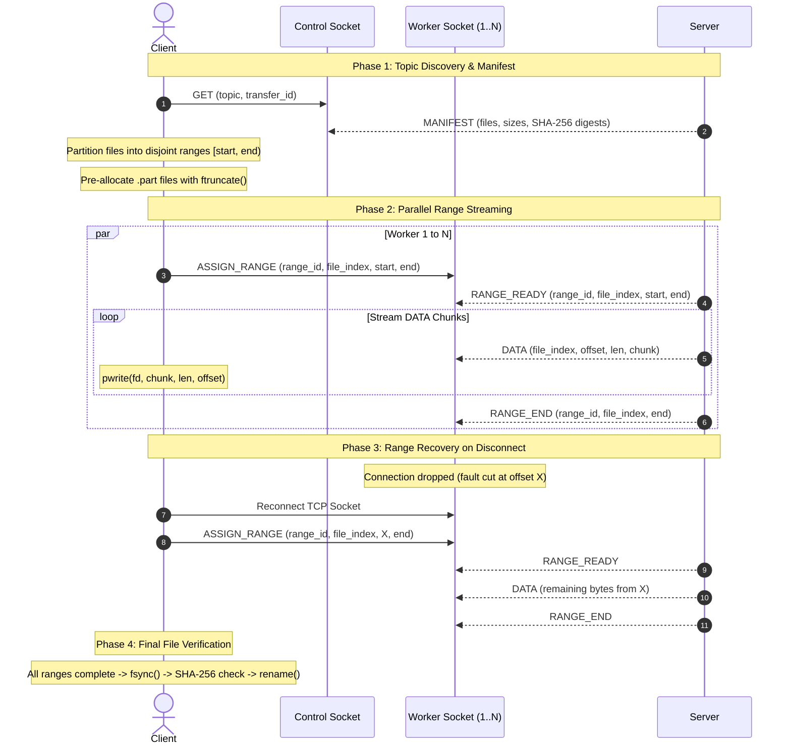

# Enhanced Case 2: Parallel TCP Connections, Non-Overlapping Range Reassembly, and Performance Analysis

**Author:** Purva Kaneria / Group 064 & 091  
**Module:** Part 2 Case 2 Enhanced (`Part2_Case2_Enhanced`)  
**Contribution Line:** *Purva: Enhanced Case 2 parallel TCP connection architecture, non-overlapping byte-range partitioning and reassembly, range fault recovery and resumption protocol, automated benchmark harness, result visualization scripts, and report analysis.*

---

## 1. Overview and Problem Formulation

In Part 2 Case 2, transfers achieve fault-tolerance via durable checkpoints and session resumption, but each transfer relies on a single sequential TCP connection. Single-stream transfers underutilize modern high-bandwidth networks, fail to saturate multi-core server I/O, and suffer from head-of-line blocking when a cut occurs.

**Part 2 Case 2 Enhanced** introduces **multi-stream parallelism** combined with **fine-grained range resumption**:
1. **Parallel TCP Connections ($N$)**: The transfer of a topic utilizes $N$ concurrent TCP connections (default $N=4$, configurable via command-line or environment variable).
2. **Non-Overlapping Range Partitioning**: Large files are divided into disjoint, half-open byte ranges $[start\_offset, end\_offset)$. Small files ($\le 128$ KiB) are assigned whole to individual workers.
3. **Safe Concurrent Reassembly**: Workers write range chunks directly into target files at explicit offsets via POSIX `pwrite()`, avoiding write races and thread contention.
4. **Independent Range Recovery**: If connection $k$ suffers an injected fault or network drop, the client reconnects and resumes **only** the unfinished portion of that specific range $[current\_offset, end\_offset)$. Completed ranges and other active connections remain completely uninterrupted.
5. **End-to-End File Integrity**: Upon completion of all ranges for a given file, the file descriptor is flushed with `fsync()`, its on-disk SHA-256 digest is verified against the server's manifest, and the temporary `.<name>.part` file is atomically renamed to its published path.

---

## 2. Wire Protocol and Message Framing

Enhanced Case 2 builds on the 28-byte frame header specified in Section 4 of the Group Design Document:
- `version` (1B), `message_type` (1B), `flags` (2B), `payload_length` (8B), `transfer_id` (16B).

The following stable message identifiers and payload formats govern range negotiation:

| Message Type | ID | Direction | Payload Structure |
|---|---|---|---|
| `ASSIGN_RANGE` | 12 | Client $\to$ Server | `range_id:u32, file_index:u32, start_offset:u64, end_offset:u64` (24 bytes) |
| `RANGE_READY` | 13 | Server $\to$ Client | `range_id:u32, file_index:u32, start_offset:u64, end_offset:u64` (24 bytes) |
| `DATA` | 4 | Server $\to$ Client | `file_index:u32, offset:u64, data_length:u32, data:[bytes]` (16B + chunk) |
| `ACK_RANGE` | 14 | Client $\to$ Server | `range_id:u32, file_index:u32, contiguous_offset:u64` (16 bytes) |
| `RANGE_END` | 15 | Server $\to$ Client | `range_id:u32, file_index:u32, end_offset:u64` (16 bytes) |

### 2.1 Range Transfer Sequence



---

## 3. Implementation Details

### 3.1 Server Architecture (`server/server_enhanced.c`)
- **Connection Multiplexing**: Listens on the designated TCP port and spawns a thread per connection.
- **Session Association**: Uses the 16-byte `transfer_id` carried in each frame header to link worker connections to active topic manifests in `SessionStore`.
- **Fault Injection**: Per-connection or per-chunk fault injection (`cn_fault_plan_connection`) operates at the range level, randomly interrupting active streams to stress client recovery.
- **Range Bounds Enforcement**: Validates that $0 \le start\_offset < end\_offset \le \text{file\_size}$. Range requests with invalid offsets or out-of-bound file indices are rejected with `CN_ERR_RANGE_REJECTED`.

### 3.2 Client Architecture (`client/main_enhanced.c`)
- **Range Task Queue**: All file slices are placed into a synchronized `range_task` linked list guarded by a `pthread_mutex_t`.
- **Worker Thread Pool**: Spawns $N$ pthreads. Each thread dequeues an unfinished range, connects to the server, and pulls data.
- **Atomic Concurrency via `pwrite()`**: Because ranges are strictly non-overlapping, multiple threads can write into different offsets of the same file concurrently without locking during I/O.
- **Resilient Range Loop**: If an error or EOF occurs before `RANGE_END`, the thread updates `current_offset`, re-establishes TCP connection, and requests only the remaining delta without discarding previously written bytes.

---

## 4. Performance Metrics and Analytical Formulas

The experimental suite measures the following metrics:

1. **Useful Bytes ($B_{\text{useful}}$)**: Total unique, verified bytes delivered to the destination topic directory:
   $$B_{\text{useful}} = \sum_{i=1}^{M} \text{size}(\text{file}_i)$$
2. **Redundant Bytes ($B_{\text{redundant}}$)**: Excess file-data payload received due to fault retransmissions:
   $$B_{\text{redundant}} = \max(0, B_{\text{data\_received}} - B_{\text{useful}})$$
3. **Goodput / Useful Throughput ($T_{\text{goodput}}$)**:
   $$T_{\text{goodput}} = \frac{B_{\text{useful}}}{t_{\text{completion}}} \quad (\text{MB/s})$$
4. **Wire Overhead Ratio ($\eta_{\text{wire}}$)**:
   $$\eta_{\text{wire}} = \frac{B_{\text{wire\_received}}}{B_{\text{useful}}}$$
5. **Retransmission Ratio ($\rho_{\text{ret}}$)**:
   $$\rho_{\text{ret}} = \frac{B_{\text{redundant}}}{B_{\text{useful}}}$$

---

## 5. Validation Results and Analysis

The current figures use actual runs from 22 October 2026, not an analytical
or synthesized data set. The workload was ten random files totaling
12,582,910 bytes on one WSL2 host over loopback. Three repetitions were run
for N=1, 2, and 4 at p=0, 0.2, and 0.5. See `Results/README.md` for provenance.

| p | N=1 MB/s | N=2 MB/s | N=4 MB/s |
|---:|---:|---:|---:|
| 0.0 | 2.39 | 4.76 | 6.86 |
| 0.2 | 2.08 | 3.90 | 6.06 |
| 0.5 | 1.05 | 2.14 | 4.23 |

At p=0, N=4 was 2.88 times faster than N=1. At p=0.2, the measured speedup
was 2.92 times. Throughput declined as faults increased, but the four-worker
configuration remained faster because unaffected ranges continued in
parallel. No complete DATA payload was received twice in this run, so
`redundant_bytes` stayed at zero; reconnect/control-frame overhead still rose
slightly with p.

The measurements establish local behavior only. They do not prove that N=4
is optimal on the lab network and do not replace the required Animals-10,
three-computer experiment.

---

## 6. Execution Instructions

1. **Build All Cases**:
   ```bash
   make clean && make all
   ```
2. **Run Unit and Enhanced E2E Tests**:
   ```bash
   make test
   make e2e_enhanced
   ```
3. **Execute Benchmark Experiments**:
   ```bash
   sh scripts/run_case2_enhanced_experiments.sh /path/to/raw-img cane 3 Results
   ```
4. **Generate Figures and Plots**:
   ```bash
   python3 scripts/plot_case2_enhanced.py Results
   ```
